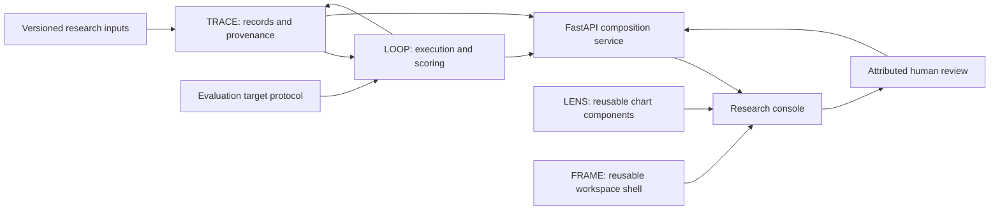

# Architecture and package boundaries

The bidirectional arrows above describe data flow, not Python import cycles. Python dependencies are `nx_schema ← nx_trace ← nx_loop`; adapters depend on the shared schemas and accept a TRACE store. `nx_api` composes these modules. React packages LENS and FRAME have no backend dependency. The console uses TanStack Query for API state and owns linked filters and selection.

## Storage

`trace_records` stores immutable version-specific entities; `logical_id` groups history. A content hash covers the entity kind, label and payload. Identity, attribution and timestamp are explicit metadata. `trace_edges` stores typed, attributed edges and hashes all input edge fields. `loop_runs` stores execution lifecycle and configuration references. `loop_results` stores individual measured predictions, scores and source record references. `frame_layouts` stores named workspace snapshots.

SQLite triggers reject updates and deletes to records, edges and results. Completed/failed runs cannot be updated, and runs cannot be deleted. A correction appends a new record, attributed reviews and new configuration/execution records. It never updates benchmark truth or a historical prediction. These controls guard the normal database/API path; a database owner can replace files or remove triggers. Hash consistency is not cryptographic proof of authenticity.

Dataset registration is idempotent by benchmark content hash. Changed content with the same project and benchmark name appends a new logical version, records a `supersedes` edge and retains the prior case definitions. Case evidence identities are scoped to their case when generating provenance links.

## Execution and transaction boundaries

1. Validate the benchmark hash, target, parameters, split, selected cases and accepted correction states.
2. Persist immutable configuration, algorithm and execution records plus a mutable `running` run.
3. Give each target a deep-copied `QueryInput`, excluding oracle labels. Measure `predict` duration with a monotonic clock.
4. In one results transaction, score against separate fixture ground truth and persist outputs, claims, evidence assessments, result rows and the evaluation summary.
5. Complete the run with a semantic digest. On a target error, roll back partial results and mark the run failed while preserving its initial configuration/execution records.

The runner serializes execution within one process. There is no distributed scheduler, job cancellation or process sandbox in this release. Trusted target adapters run in the service process. Avoid untrusted target code; the HTTP API accepts data, never uploaded executable code.

## Interface state

Saved layouts contain the active view, selected run, family filter and inspector width. Transient record selection, table page, search and latency-bin selection remain local UI state. Desktop uses adjacent analytical panels and an inspector; narrower viewports open the inspector as an overlay. Mobile starts with the inspector closed. Tables scroll within their own panels.

LENS marks carry source IDs and callbacks. The console joins those IDs to TRACE inspection; charts do not infer provenance independently. Visual distinctions separate measured timing, processed accuracy, oracle assessment and human interpretation. Optional interval bounds are rendered only when supplied by the caller; the fixture runner supplies none.

## Migrations and recovery

Alembic revision `0001` establishes the schema and guards. `nx-stack init` initializes and upgrades a source checkout. Destructive downgrade is deliberately disabled. Back up a live SQLite database with its backup API, or stop the service before copying database/WAL files. Future changes must append migrations and retain logical IDs and history; no destructive migration is implemented.

An abrupt process termination can leave a `running` entry; there is no automatic claim that such a run completed. Restarting the service preserves it. Launch a new run for the same configuration and investigate the abandoned execution separately.
