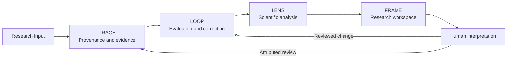

# Proposed Nurowerx website copy — unpublished

## Nurowerx Research Systems

**FROM INFORMATION TO UNDERSTANDING.**

TRACE, LOOP, LENS and FRAME connect research inputs, computational behavior, evidence and human judgment in one inspectable workflow.

**TRACE — Follow the evidence.**
Versioned records and typed relationships make computational claims investigable. Examine an output's source, execution and configuration; distinguish citations from assessed support; preserve annotations and revisions.

**LOOP — Evaluate changes through measured behavior.**
Run controlled benchmarks, inspect failures, review corrections and compare subsequent executions. Effective configurations and historical results remain available for reproduction.

**LENS — Keep analysis connected to its source.**
Compose scientific charts from actual measurements, link selections across analytical views, and open the records behind a plotted result. State denominators, units and uncertainty boundaries explicitly.

**FRAME — Investigate in one workspace.**
Organize datasets and experiments, execute evaluations, inspect provenance and record human interpretation within a coherent research interface.

## Suggested placement

| Website area | Proposed content |
|---|---|
| Capabilities / AI Infrastructure | TRACE provenance and LOOP evaluation contracts |
| Capabilities / Explainable AI & Information Science | Evidence relationships, source lineage and attributed assessments |
| Capabilities / Scientific Visualization & Research Methods | LENS components, linked inspection and transparent metric definitions |
| Capabilities / Human–Computer Interaction | FRAME analytical workspaces and review workflows |
| Research | Methods, evidence semantics, evaluation design and explicit limitations |
| Technical Work | Source, reproducible examples, verified adapters and automated validation |
| Future homepage feature | A concise four-system introduction linked to the dedicated Research Systems page |

## Technical-work caption

The initial local implementation evaluates deterministic evidence policies on 120 synthetic cases. Its working demonstration traces a failed result to its source, records a reviewed rule change, reruns affected cases and exports a reproducible report. These measurements validate the software workflow and programmed fixtures; they are not language-model or human-participant research findings.

The Epistemic Trust Lab integration currently imports and verifies an existing synthetic export. Resident Model Lab support is a representative contract awaiting verification against real exports.

## Architecture illustration

Use the delivered interface screenshots and architecture diagram only with captions identifying synthetic fixtures. Do not imply institutional sponsorship, peer review, participant studies, or real-model performance. This copy is prepared for future review; no website files were changed or published.
