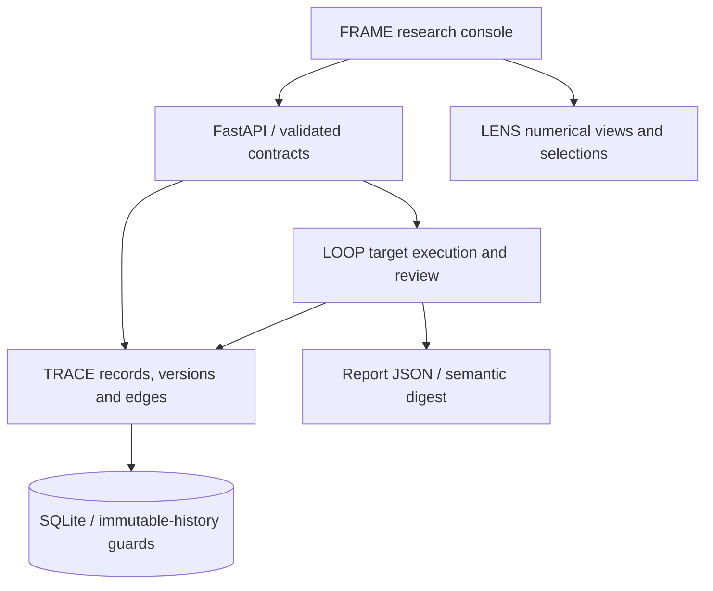

# Nurowerx Research Systems: A Modular Architecture for Evidence Provenance, Computational Evaluation, Scientific Visualization, and Human Review

Spencer H. Walker · Nurowerx · [ORCID 0009-0005-3574-1057](https://orcid.org/0009-0005-3574-1057)

Technical report, version 1.0, 2 November 2026. Software: NRS 0.1.0. CC BY 4.0. Not peer reviewed. AI-assisted implementation and manuscript preparation; all empirical claims below refer to executed software observations. No participants, independent replication, university sponsorship or DOI are claimed.

## Abstract

Nurowerx Research Stack (NRS) is a local research application connecting typed provenance records, executed evaluations, scientific charts and attributed review. Four modules—TRACE, LOOP, LENS and FRAME—share version-specific identifiers and schemas. The resulting workflow preserves a dataset, execution configuration, output, assessment, correction and subsequent report without overwriting earlier evidence. This report describes the implemented architecture and its limits. Release validation comprises 35 backend, 12 visualization and 7 browser tests, together with 18 controlled evaluation executions across three synthetic seeds. The contribution is an inspectable integration and reproduction package. It does not establish real-world predictive validity, authenticated authorship or human-user benefit.

## 1. Introduction and motivation

A research result often travels through several representations: source data, an execution record, a plotted aggregate, a written interpretation and a later correction. If those representations lose their identity or configuration, it becomes difficult to determine which evidence supported a conclusion. NRS makes those connections explicit in a functioning application. A researcher can inspect a failed synthetic result, follow its evidence, record a correction, obtain a review, rerun a defined scope and export both the outcome and its configuration.

The design separates observed execution results from attributed judgments. A citation alone does not make a claim supported; conflicting assessments remain visible. Corrections modify a subsequent configuration rather than replacing the historical output. This is a practical evidence-management mechanism, not a model of scientific truth.

## 2. Related work

PROV-DM [1] supplies a conceptual vocabulary for entities, activities and responsible agents. NRS uses related ideas in a smaller application-specific schema; it does not claim W3C PROV conformance. Scientific software practices [2] and reproducibility work [3] motivate versioned source, executable checks and explicit reproduction instructions. Munzner's validation levels [4] inform the distinction between a correct rendering algorithm and usefulness for a domain task. Human-AI interaction guidance [5] motivates visible feedback and review state, without supplying evidence that NRS improves human judgment.

Dataset documentation [6] motivates explicit origin, construction and reuse limits. Explanation techniques such as LIME [7] address local model behavior; NRS instead preserves recorded evidence and processing history. NRS does not implement LIME or establish explanatory fidelity for a learned model. Palantir's public examples [8] informed typed retrieval, feedback workflows, chart composition and dense interfaces. They were inspected at pinned commits; no proprietary service, source copy or enterprise dataset is included.

## 3. Requirements and architecture

Requirements were version-specific evidence identity, explicit execution configuration, immutable completed observations, interpretable denominators, inspectable review history, linked numerical displays and portable reproduction. The implementation keeps a Python API and a TypeScript console, with small packages for the four modules and shared schemas. SQLite is the validated database.

*Figure 1. Implemented module boundaries. The diagram describes software responsibilities, not a distributed deployment.*

| Contract | Preserved information |
|---|---|
| Entity and edge | Kind, payload, attribution, identity, version and content digest; relation endpoints and assessment |
| Evaluation request | Dataset version, target, parameters, split, case IDs, repeats, correction IDs and parent run |
| Result | Case identity, repetition, prediction, scores, measured latency and evidence/claim identifiers |
| Report | Dataset, configuration, execution environment, results, corrections, comparison and reproduction digest |

## 4. TRACE design

Records have physical IDs and logical version identities. New versions retain the logical identity and link to prior versions. Database guards reject ordinary updates and deletions of protected rows. Typed edges distinguish derivation, generation, evaluation, support, contradiction and review relationships. Causal derivation cycles and cross-project relationships are rejected; conflicting support and contradiction can coexist as a visible state.

Bounded graph traversal supports source inspection. Claim-state logic distinguishes citation-only linkage from assessed support and missing lineage. A hash check verifies stored canonical content. The graph-exchange endpoint validates identity uniqueness, version continuity, endpoint existence and hashes before committing a transaction. Reimporting an identical graph adds nothing. Exchange preserves TRACE evidence; it does not rebuild executable LOOP run tables.

## 5. LOOP design

LOOP registers versioned benchmarks and passes only query inputs to a target. The target does not receive the expected-answer field through this interface. Predictions are scored against fixture ground truth, then stored with execution and evidence records. Completed results remain immutable. A synchronous target exception records a failed run; abrupt process termination can leave an observable running row with no committed partial results.

Corrections are proposals tied to a development result. Reviews are append-only and can disagree; an accepted, undisputed correction is required before applying it. A rerun records the effective configuration and parent linkage. Affected-case and full-split runs remain distinct, and comparisons disclose partial overlap. Repeated calls test consistency; unique cases define the accuracy denominator.

## 6. LENS and FRAME design

LENS renders ratio bars, latency scatterplots and histograms, time series and provenance graphs. Source identifiers link marks to records. Shared filtering updates result tables, while SVG export retains measurement attributes. Missing values are explicit, incomplete intervals are rejected and missing time samples break line segments. The supplied interval is displayed according to its declared inputs; a chart does not create statistical validity.

FRAME integrates project selection, datasets, execution setup, result inspection, annotation versions, correction review, saved layouts and JSON report preview/export. The report preview displays the actual API report. Automated browser tests cover these operations, accessibility rules and a 390-by-844 mobile viewport. These checks are not a usability study, and shared actor labels are not authenticated researcher identities.

## 7. Implementation and reproduction

The backend uses FastAPI, Pydantic and SQLAlchemy; React, TypeScript, Vite and D3 provide the console. Dependency locks, packaged migrations, a source archive and a clean-install script support reproduction. Run `python scripts/clean_install.py --destination ../nrs-check` from a fresh clone. The script uses new environments and a new database, records logs, exercises the browser workflow and compares a semantic report digest. CI and research observations are indexed in [validation](../../docs/validation/README.md).

## 8. Limitations and discussion

The integration provides an inspectable chain of recorded processing, not trusted evidence certification. Administrators can bypass database guards, rewrite files and recompute hashes. Record content hashes do not authenticate actor metadata. Remote access uses shared tokens rather than user-specific roles. Evaluations are synchronous, the graph view is bounded, and large-scale throughput has not been established. PostgreSQL is not a validated target.

The benchmark uses deterministic policies and constructed cases. The architecture can host additional targets, but its current results cannot be generalized to language models or scientific disciplines. External replication, authenticated review and recovery of interrupted work are priorities. The AI-assisted development process and common authorship of implementation and tests further motivate outside review.

## 9. Conclusion and availability

NRS connects provenance, evaluation, visualization and review in an executable local workflow. Its principal evidence is the source, explicit contracts and recorded controlled validation. Software is MIT; original datasets and reports are CC BY 4.0. The software version is available from https://github.com/Nurowerx/research-stack/releases/tag/v0.1.0. The separate evaluation and benchmark reports define empirical scope. No independent-party reproduction or archival DOI is asserted.

## References

1. Moreau, L., and Missier, P., eds. (2013). *PROV-DM: The PROV Data Model*. W3C Recommendation, 30 April 2013. https://www.w3.org/TR/2013/REC-prov-dm-20130430/
2. Wilson, G., et al. (2014). Best Practices for Scientific Computing. *PLOS Biology*, 12(1), e1001745. https://doi.org/10.1371/journal.pbio.1001745
3. Pineau, J., et al. (2021). Improving Reproducibility in Machine Learning Research (A Report from the NeurIPS 2019 Reproducibility Program). *JMLR*, 22(164), 1–20. https://www.jmlr.org/papers/v22/20-303.html
4. Munzner, T. (2009). A Nested Model for Visualization Design and Validation. *IEEE TVCG*, 15(6), 921–928. Author publication record: https://www.cs.ubc.ca/labs/imager/tr/2009/NestedModel/
5. Amershi, S., et al. (2019). Guidelines for Human-AI Interaction. *CHI 2019*. Author publication record: https://www.microsoft.com/en-us/research/publication/guidelines-for-human-ai-interaction/
6. Gebru, T., et al. (2021 revision). Datasheets for Datasets. arXiv:1803.09010v8. https://arxiv.org/abs/1803.09010v8
7. Ribeiro, M. T., Singh, S., and Guestrin, C. (2016). “Why Should I Trust You?”: Explaining the Predictions of Any Classifier. arXiv:1602.04938v3. https://arxiv.org/abs/1602.04938v3
8. Palantir Technologies. Public ontology starter, AIP community registry, Plottable and Blueprint repositories. Versions and inspected files in [the pinned reference manifest](../references/palantir-sources.json), retrieved 2 November 2026. Qualitative design references, not measured comparison systems.
