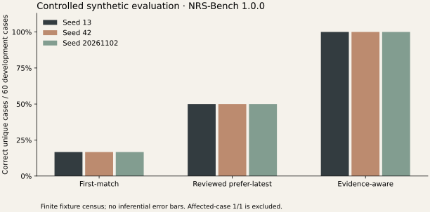

# Evaluating an Evidence-Centered Research Software Stack: Provenance Integrity, Reproducibility, Correction Workflows, and Visualization Fidelity

Spencer H. Walker · Nurowerx · [ORCID 0009-0005-3574-1057](https://orcid.org/0009-0005-3574-1057)

Technical report, version 1.0, 2 November 2026. Software: NRS 0.1.0. CC BY 4.0. Not peer reviewed. AI-assisted implementation and manuscript preparation; all empirical claims below refer to executed software observations. No participants, independent replication, university sponsorship or DOI are claimed.

## Abstract

We evaluate NRS 0.1.0 using known-answer synthetic fixtures, deliberate faults, paired correction comparisons and automated browser workflows. Three prespecified seeds generate 120 cases each, with 60 development and 60 heldout instances. Across 18 recorded executions, first-match achieves 10/60 correct development cases per seed, evidence-aware achieves 60/60, and a reviewed prefer-latest configuration achieves 30/60. The selected affected case achieves 1/1 and is reported separately. A fresh Windows installation passes 54 automated tests and reproduces the committed report digest. These observations establish bounded implementation behavior; they do not estimate real-world predictive performance or human-user outcomes.

## 1. Research questions

RQ1 asks whether typed provenance survives traversal and exchange while controlled inconsistencies are rejected. RQ2 asks whether fixed inputs reproduce semantic outputs. RQ3 asks whether reviewed corrections preserve the original state and expose full-split changes. RQ4 asks whether plotted numbers and interactive views agree with source records. These questions concern software correctness and reproducibility, as distinguished from domain validity [2–4].

## 2. Benchmark design and data provenance

NRS-Bench 1.0.0 includes original provenance, evaluation and visualization fixtures. Seeds 13, 42 and 20261102 were specified before the expanded experiment run. Each evaluation dataset contains 20 cases in each of six families: lookup, revision, conflict, missing, distractor and recovery. Ten cases per family are development cases and ten are heldout. Expected answers and acceptable evidence identities follow explicit construction rules.

All data are synthetic. The policy implementations are deterministic programs, not learned language models. Heldout instances share the generator and therefore do not provide an external distribution test. Public Palantir examples were inspected as design references [8]; no enterprise data or external performance result was used as an NRS observation. Dataset documentation follows the transparency motivation of [6].

## 3. Experimental methods and metrics

For each seed, we execute first-match twice, evidence-aware on development and heldout splits, and reviewed prefer-latest on affected and full development scopes. Each execution makes two calls per selected case. The second baseline run tests semantic repetition. The correction is proposed from revision-000 and accepted by a scripted reviewer explicitly labeled as such. No human participant performed the benchmark review.

Accuracy counts correct unique cases. Per-call repetition is retained for consistency checks but does not double the accuracy sample size. Comparisons pair shared case IDs within the same benchmark version and split. Improvement and regression count directional changes in correctness. Partial overlap is explicit. The negative regression control compares the evidence-aware result against first-match in reverse direction.

TRACE uses a seven-node, six-edge reference graph with an exact reachable set and byte-equivalent normalized graph exchange. Negative tests alter content, endpoints, identities, histories or edge metadata and assert atomic rejection. LENS checks chart coordinates against independent linear arithmetic, a supplied normal interval against SciPy's normal quantile, aggregation denominators, outliers and missing-data gaps. FRAME tests execute the actual application through Chromium, including keyboard selection, saved layouts, SVG export and a controlled server failure.

## 4. Executed results

| Configuration | Scope / seed | Correct unique cases | Accuracy |
|---|---|---:|---:|
| First-match | 60 development cases | 10/60 | 16.67% |
| Repeated first-match | Same 60 cases | 10/60 | 16.67% |
| Evidence-aware | 60 development cases | 60/60 | 100% |
| Evidence-aware | 60 heldout cases | 60/60 | 100% |
| Reviewed prefer-latest | Full 60 development cases | 30/60 | 50% |
| Reviewed prefer-latest | Selected revision-000 only | 1/1 | 100% |

*Table 1. Each row was executed for each of the three seeds. Repeats and seeds are not pooled into an estimated population accuracy.*

*Figure 1. Development results per seed. Identical finite-case proportions across seeds are shown without inferential error bars. The 1/1 affected-case result is excluded from this full-split plot.*

The full correction improves 20 of 60 paired cases, with no correctness regressions in that comparison. It leaves 30 cases incorrect. The reverse evidence-aware-to-first-match control detects 50 regressed cases. Repeated baseline runs have identical semantic digests. All seven expected graph nodes are reached and graph round-trip equality holds. The 501-record bounded stress case completes and passes integrity verification; elapsed time and process RSS are recorded as descriptive observations in summary.json.

| Automated suite | Executed outcome |
|---|---|
| Historical baseline, separately rerun | 23 backend + 3 chart + 5 browser = 31 passed |
| Release backend and integration | 35 passed |
| Release visualization | 12 passed |
| Release browser workflow | 7 passed; no skipped or flaky tests |
| Fresh installation | New environments/database, build, service, Vite proxy and report reproduction passed |

Raw reports, environment information, source commit and logs are indexed in [release evidence](../../docs/validation/README.md). The historical baseline remains separate and is not added to the 54 release tests.

## 5. Failure analysis

The audit first reproduced four new frontend regression failures: null measurements, incomplete interval handling, empty histograms and missing time-series data. Fixes were evaluated against those controls; both before and after results are retained. ETL repeat imports previously added duplicate evidence; release tests now assert idempotence. Migration lookup depended on a source layout; migrations are now packaged with the API. Conflicting duplicate relationship metadata now raises an error rather than discarding a different judgment.

A hard-interruption experiment terminates the target process with exit code 17. The original run remains marked running, and no partial result rows become visible. A new run completes. This is safe visibility of incomplete work, not automated recovery. A browser screenshot attempt also failed because a download endpoint was treated as a navigable page; the final workflow uses a tested preview of the actual exported JSON. These failures informed release changes and were not relabeled as successful measurements.

## 6. Reproducibility and comparisons

The recorded fresh-install run used Windows, Python 3.11.9 and Node 24.20.0. It recreated the environment and database and reproduced digest `237c0a705f41edd0fed470db054237505c9359ec1884a3049a23a4178b00c464`. A match excludes latency, UUIDs and timestamps, which are expected to vary. The digest includes predictions and scores, so it tests computation rather than merely reloading a saved metric. CI provides additional platform executions; their exact statuses and commits are reported in the validation ledger.

The measured comparison is between NRS's own deterministic policies and corrected configurations. External systems were not executed under a shared protocol. Palantir-related discussion is qualitative. Independent-party verification has not occurred; developer-controlled reruns and CI do not satisfy that stronger claim [3].

## 7. Statistical interpretation and threats to validity

The data form a designed finite census. No accuracy confidence interval, significance test or causal effect estimate is appropriate for a population that was not sampled. The normal confidence interval exists only as an explicitly specified mathematical chart fixture. Timing and RSS are single-process snapshots affected by caches, system load, interpreter state and database size; they do not establish capacity or tail latency.

Common authorship of policies, generators and tests can conceal shared errors. Structurally related seeds offer limited diversity. Rendering checks do not prove perceptual effectiveness [4], and automated accessibility checks do not replace assistive-technology or human-use studies [5]. Hash verification does not establish authentic authorship or evidence truth [1]. These limits restrict the interpretation to controlled software behavior.

## 8. Discussion and conclusion

The suite supplies concrete evidence that NRS preserves and reproduces the tested workflow and detects designated failures. Full-split results reveal the correction's incomplete coverage even when its selected case succeeds. The next research steps are independent replication, externally authored cases, stronger identity and interruption handling, and a prespecified human-use study. Source, raw observations and instructions are available with the v0.1.0 release; the findings remain technical validation rather than general AI or usability claims.

## References

1. Moreau, L., and Missier, P., eds. (2013). *PROV-DM: The PROV Data Model*. W3C Recommendation, 30 April 2013. https://www.w3.org/TR/2013/REC-prov-dm-20130430/
2. Wilson, G., et al. (2014). Best Practices for Scientific Computing. *PLOS Biology*, 12(1), e1001745. https://doi.org/10.1371/journal.pbio.1001745
3. Pineau, J., et al. (2021). Improving Reproducibility in Machine Learning Research (A Report from the NeurIPS 2019 Reproducibility Program). *JMLR*, 22(164), 1–20. https://www.jmlr.org/papers/v22/20-303.html
4. Munzner, T. (2009). A Nested Model for Visualization Design and Validation. *IEEE TVCG*, 15(6), 921–928. Author publication record: https://www.cs.ubc.ca/labs/imager/tr/2009/NestedModel/
5. Amershi, S., et al. (2019). Guidelines for Human-AI Interaction. *CHI 2019*. Author publication record: https://www.microsoft.com/en-us/research/publication/guidelines-for-human-ai-interaction/
6. Gebru, T., et al. (2021 revision). Datasheets for Datasets. arXiv:1803.09010v8. https://arxiv.org/abs/1803.09010v8
7. Ribeiro, M. T., Singh, S., and Guestrin, C. (2016). “Why Should I Trust You?”: Explaining the Predictions of Any Classifier. arXiv:1602.04938v3. https://arxiv.org/abs/1602.04938v3
8. Palantir Technologies. Public ontology starter, AIP community registry, Plottable and Blueprint repositories. Versions and inspected files in [the pinned reference manifest](../references/palantir-sources.json), retrieved 2 November 2026. Qualitative design references, not measured comparison systems.
